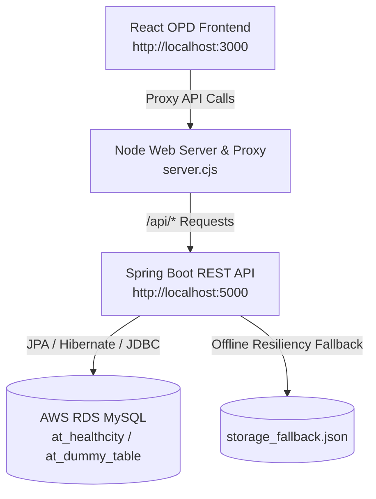

# INDUS HEALTH CITY — Hospital Outpatient (OP/OPD) & HIMS System

An enterprise Hospital Information Management System (HIMS) and Outpatient (OPD) Patient Portal built with **Spring Boot (Java)**, **MySQL**, **React**, and **Node.js**.

---

## 🏗️ Architecture Overview



### Tech Stack Breakdown:
- **Backend**: Spring Boot 2.7.18 (Java 8 / 11 / 17 / 21 compatible) with Spring Data JPA & HikariCP.
- **Database**: MySQL (AWS RDS / local MySQL with JDBC connector).
- **Frontend**: React 18 with modern hospital OPD screens, Queue Lobby, Digital Token Slips, and Vitals.
- **Node.js**: Embedded high-performance static server & reverse proxy (`server.cjs`).
- **Resiliency**: Automatic offline local JSON fallback cache (`storage_fallback.json`) ensuring 100% demo uptime even when the remote MySQL database is offline.

---

## 🌟 Key Features

1. **Live OPD Token Waiting Lobby Screen**:
   - Multi-room board displaying consulting cabins (Cardiology, Ortho, General Medicine, Pediatrics, Dermatology, ENT).
   - "Now Serving" vs "Next in Line" indicators.
   - Real-time sound chime synthesizer (via Web Audio API) when patients are called.
   - Live announcement alerts.

2. **Instant OP Patient Registration**:
   - Fast intake form with patient demographics, symptoms, and priority triage (Standard OP, Senior Citizen Fast-Track, Emergency Walk-in).
   - Instant generation of an authentic **Digital OP Token Slip** with barcode, token number, estimated time, and assigned cabin.
   - One-click print/PDF option.

3. **Consultant Doctors Schedule & Cabin Roster**:
   - Detailed doctor profile cards, specialties, qualifications, OPD morning/evening hours, and consultation fees.
   - Quick filter by medical department.
   - Direct "Book OP Token" shortcut.

4. **Patient OP Records & E-Prescription Viewer**:
   - Search by Token (e.g. `CAR-104`, `GEN-211`, `ORT-082`, or newly registered tokens).
   - Recorded clinical vitals dashboard (Blood Pressure, Heart Rate, SpO2, Temperature, Weight, BMI).
   - Doctor's provisional diagnosis and digital prescription (Rx) table.
   - Recommended diagnostic and lab test orders.

5. **Pharmacy Billing & Dispensing Screen**:
   - Prescription medicine fulfillment, automatic tax and total calculation.
   - Generates digital pharmacy invoices stored directly to MySQL `pharmacy_invoices`.

6. **Live MySQL `at_dummy_table` Verification**:
   - Live test console to insert, query, and delete records from MySQL `at_dummy_table` (`id`, `name`, `created_at`).

---

## 🚀 How to Run

### Option 1: Full-Stack One-Click Launch (Recommended)
Double-click:
```bat
start_with_springboot.bat
```
This automatically:
1. Boots the Spring Boot MySQL REST API on port `5000`.
2. Starts the Node web server and reverse proxy on port `3000`.
3. Opens your browser directly to [http://localhost:3000](http://localhost:3000).

---

### Option 2: Standalone Spring Boot Backend Launch
Double-click:
```bat
start_springboot.bat
```
Or run via terminal:
```bash
cd backend-spring
mvnw.cmd spring-boot:run
```
Or run the packaged JAR directly:
```bash
java -jar backend-spring/target/healthcity-backend-1.0.0.jar
```
Spring Boot API will be live at [http://localhost:5000/api/health](http://localhost:5000/api/health).

---

### Option 3: Command Line via Node
```bash
npm start
```

---

## 📱 Access from Mobile Phones, Tablets & Other Laptops

INDUS HEALTH CITY is fully configured for multi-device access across your entire hospital or office network:

### Method A: Local Wi-Fi / LAN Network (Fastest)
1. Run [allow_firewall.bat](file:///c:/Users/USER/Pictures/HEALTH-CITY/allow_firewall.bat) once (grants Windows Firewall permission for incoming connections on ports 3000 & 5000).
2. On any phone, tablet, or other laptop connected to the same Wi-Fi, open:
   ```
   http://10.150.250.111:3000
   ```
3. **Instant Phone QR Code**: Open [http://localhost:3000/qr](http://localhost:3000/qr) on this computer and point your smartphone's camera at the screen to open the app instantly!

### Method B: Access from Anywhere in the World (4G/5G / Remote)
Double-click:
```bat
start_mobile_access.bat
```
This automatically establishes an encrypted Cloudflare Tunnel and generates a public HTTPS link (e.g. `https://*.trycloudflare.com`) accessible on any phone or laptop anywhere without needing to be on the same Wi-Fi!

---

## 🗄️ MySQL Database Configuration

Configured in `backend-spring/src/main/resources/application.properties` or `.env`:

| Parameter | Value |
|-----------|-------|
| **JDBC Driver** | `com.mysql.cj.jdbc.Driver` |
| **JDBC URL** | `jdbc:mysql://atri.cluster-ro-cdk4i6gkepve.ap-south-1.rds.amazonaws.com:3306/at_healthcity` |
| **Username** | `admin` |
| **Password** | `Client123` |

### Database Tables:
- `patients`: Patient demographics, OPD tokens, vitals JSON, and prescriptions.
- `patient_vitals`: Detailed clinical measurements (BP, pulse, SpO2, glucose).
- `patient_prescriptions`: Prescribed medicines and diagnostic orders.
- `pharmacy_invoices`: Invoices generated at the hospital pharmacy counter.
- `department_queues`: Real-time queue counters per medical department.
- `at_dummy_table`: Test table verifying write & read operations directly in MySQL.

---

## 🧭 Future Expansion (Angular & Node Microservices)

- **Angular Doctor Portal**: An Angular 17+ consultant workstation can consume the exact same Spring Boot REST endpoints (`/api/records`, `/api/vitals`, `/api/departments`) on `http://localhost:5000`.
- **Node.js WebSocket Gateway**: Node.js can act as a real-time event broker sending WebSocket queue push notifications to the lobby screen when tokens advance.
